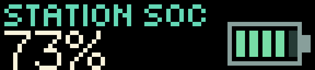

# Reserve Dial

See EcoFlow DELTA 2 charge and the time available before your chosen reserve.

A station’s time-to-empty includes charge you may want to keep for later. Reserve Dial estimates how long you can keep the present load running before you reach your own floor.

The five cells show the reported state of charge. On the reserve page they show the remaining share of usable charge above the configured reserve. The load page gives watts.

## Budget time above reserve

1. Set your reserve percentage on the companion and connect your DELTA 2 account as described below.
2. Read **STATION SOC** for the current percentage. The rear gives input, output and reserve together.
3. Turn to **TO RESERVE**. The displayed time is an estimate at the present load. In the example, 73% gives about 3 hours 25 minutes above a 20% reserve.



## Recheck after changing the load

1. Switch off or connect the appliance whose effect you want to measure. Give the station time to report the new load.
2. Turn back to charge or browse onward to **LOAD** for output watts. Click for a reading from the companion.
3. Pin the page you need with **Start**. A missing discharge estimate appears as `--` on the time page.


## Example from the emulator

The sample reported 161 W of output and 283 minutes to empty. The usable share of that runtime is (73 − 20) ÷ 73. Multiplying by 283 gives about 205 minutes. The estimate will change if the station’s load changes. The recording used a simulated EcoFlow response with these values, processed by the same parser used for a connected station.

## Set up the source

Set ECOFLOW_ACCESS_KEY, ECOFLOW_SECRET_KEY and ECOFLOW_SERIAL locally for your own station. The JSON config accepts reserve_percent and the official API origin for your region. Time to reserve scales the reported time to empty by the usable charge fraction at the current load. Charging or unknown telemetry shows no countdown. Vendor documentation: https://developer-eu.ecoflow.com/us/document/delta2.

## Connect the bar

Copy companion/example.json to a private config.json and adjust it for your source. From the project folder run `python3 companion/serve.py --config config.json`. Use Python 3.10+. Set Local companion URL to `http://127.0.0.1:8770/reading` on the emulator and allow local port 8770. On hardware, bind the companion to a trusted LAN interface and set its reachable address. The wheel browses pages. Click refreshes. Start pins or unpins the current page. The last good reading is labeled offline after a source error.

## Run in the emulator

Open BUSY Bar Emulator. From this repository, run:

```sh
~/.busy-emulator/bin/busy-emulator dev --once
```

Press **Back** to exit.

The GIFs are excerpts from the emulator recording. Each front-display pixel is shown at 9× its original width and height. The end frames pause for reading.

[Full recording](media/controls.mp4) · [Rear display](screenshots/back-1.png) · [Firmware test](EMULATOR-QA.md) · [MIT license](LICENSE)
